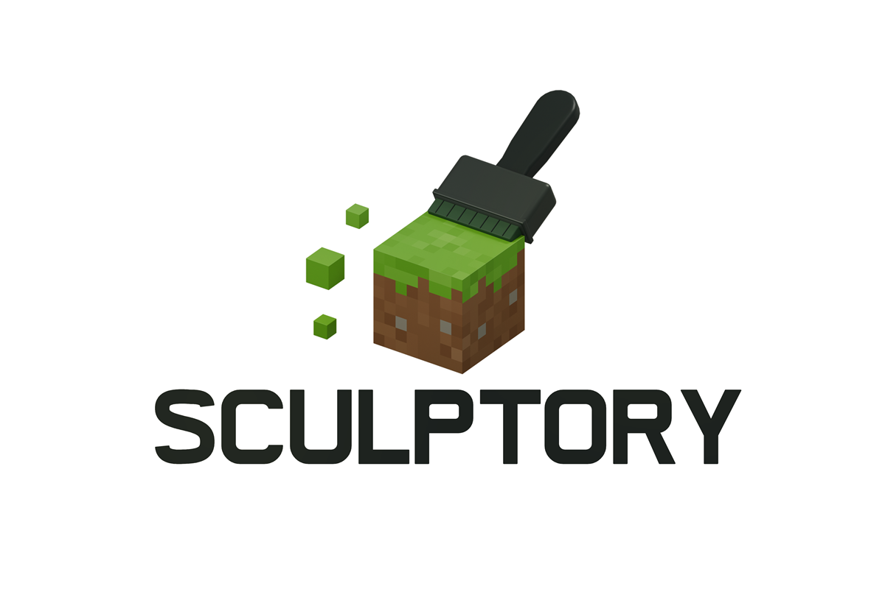
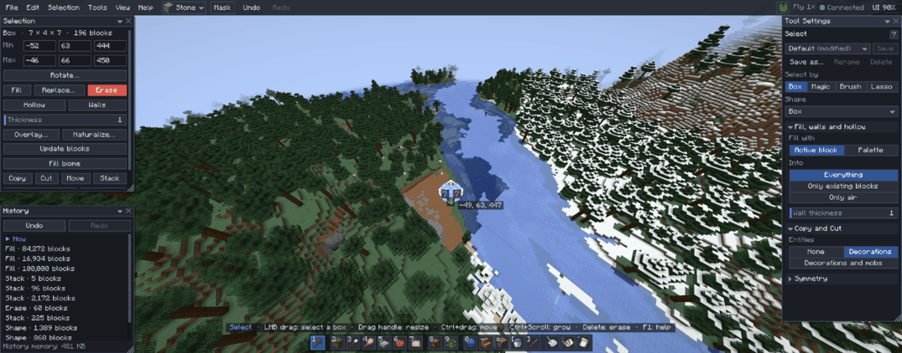
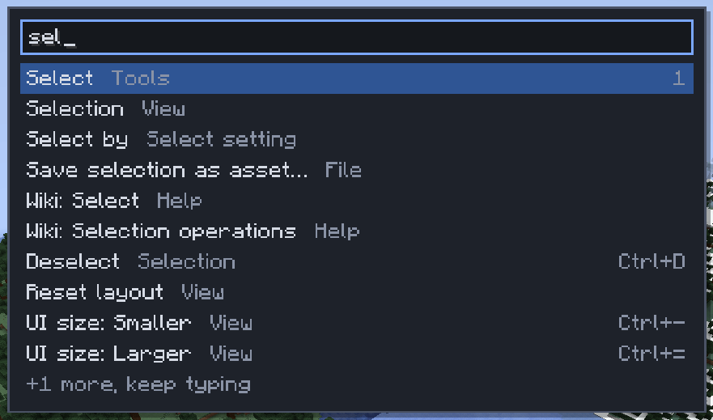
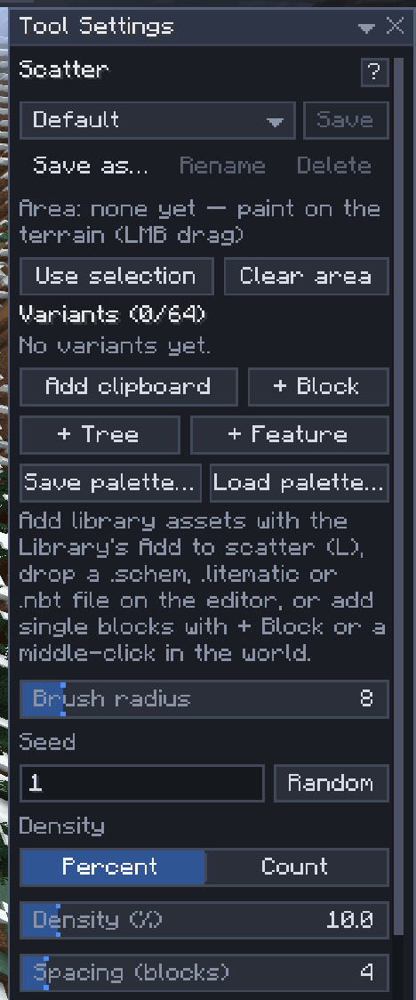
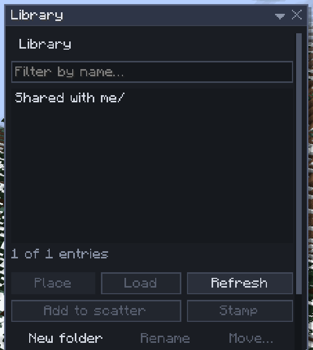
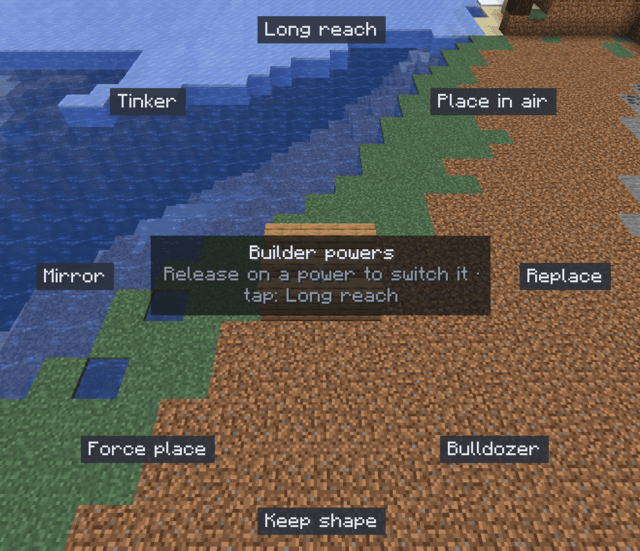

# Sculptory

<p align="center"></p>

Sculptory is an open-source world editor for Minecraft builders, for **Minecraft 1.21.1** on **Fabric**, with
**NeoForge** and **Paper** versions on the way (see [Install](#install)). Press `B` and the game turns into an editor:
floating windows, a tool palette, brushes that shape terrain, selections you can fill, copy, turn and stack,
schematics, a shared library, scatter and one undo history for all of it. It works in singleplayer and on dedicated
servers, where the server decides who may edit.

> **Beta.** The main tools are done, and what you save (settings, layouts, presets, undo history, the library) carries
> over to newer Sculptory versions for the same Minecraft version: see [Updating Sculptory](docs/wiki/updating.md).
> Most of it is covered by automated tests, but parts haven't been played much yet. Keep backups of worlds you care
> about, and see [Known limits](docs/wiki/faq.md#known-limits).



## Features

- **Editor mode and windows.** `B` opens the editor (best in Creative, to fly): tools, settings, history and the library live
  in windows you can move, resize and hide. A menu bar, `Ctrl+K` to find any command by name, `F1` for every key. Every
  key can be rebound. Fly at 0.25× to 8× speed by scrolling, or with `/sculptory flyspeed` (`/flyspeed` where the server
  has no command of that name): the speed is saved and also applies when you fly outside the editor.
- **Selections and operations.** Select a box, a sphere, cylinder, cone or pyramid, connected blocks (magic select),
  or paint a selection with a brush or a lasso; the box's handles show through blocks and stay grabbable. Fill,
  Replace (keeping stair shapes, or a whole block family), Erase, Hollow, Walls, Overlay, Naturalize and Update blocks,
  with progress and cancel, up to millions of blocks.
- **Masks.** Limit every edit, or one brush, to the blocks you choose: by block or tag, on top of, under or next to
  something, solid, height, slope, inside the selection, random, each with "not".
- **Terrain, Weather and Heightmap brushes.** Raise, Lower, Smooth, Flatten, Paint and Palette Paint up to radius 32,
  on any surface (walls and overhangs too), with falloff and symmetry. The Weather brush erodes, fills in, roughens or
  melts. The Heightmap brush stamps or paints hills, craters and ridges from grayscale pictures, built in or your own
  PNGs, up to radius 128.
- **Smart Surface.** Click points round an area and inside it: a terrain-like sheet fills the outline through every
  point, smooth or faceted, with a top layer and a body, as a sheet or filled down to the ground.
- **Biomes.** The Biome tool paints biomes or fills the selection with one; biomes can travel with copy, paste, move,
  stack and `.schem` files, and Biome view tints the ground by biome.
- **Shape brush with lines.** Click to place spheres, cylinders, cones, cubes and pyramids, drag to paint them, or sweep
  them along straight lines, curves and hanging cables.
- **Paste, move and stack** with rotate, flip and upside-down flip, ghost previews and a placement gizmo. Entities come
  along (item frames, armour stands, optionally mobs).
- **Free rotation.** Turn a paste, a move or the selection (**Rotate…**) by any angle around any axis, with the gizmo's
  rings or typed angles. Nearest, Exact count or Smooth decides how the turned blocks land on the grid, and Smooth
  slopes puts stairs and slabs on turned slopes.
- **Schematics.** Import and export `.schem` (WorldEdit-compatible), `.litematic` and structure `.nbt` files.
- **Library.** The server's shared folder of schematics and block palettes, with folders, per-asset access and
  "shared with me".
- **Scatter** vanilla trees and features, your own schematics, rocks and plants over an area, with rotations, mirrors
  and a preview before you commit. `Alt+click` places one.
- **Tinker.** Change one block's properties, a sign's text or an entity in place, by scrolling over it.
- **Builder mode.** Hold `G` in normal creative play for a ring of powers, without opening the editor.
- **Jump.** `J` puts you on the block you look at, `Shift+J` through the wall.
- **Generate and Extrude.** Generate builds roads, roofs, lines and curves, sweeps a profile along a path, stamps copies
  along a path and shapes terrain from a heightmap picture. Extrude pulls a face out, carves it in, smears it, carries
  it along a path or tapers it to a point. Line, Sweep and Smart Surface can **Extend to ground**; Line and Road can
  **Use stairs and slabs** on their slopes.
- **Path points.** Roads, lines, sweeps, stamps, Smart Surface, Extrude's paths and the Shape brush's lines share one
  point editor: points on blocks (or in the sky), a gizmo to drag them along an axis, in a plane or freely, and new
  points inserted on the path or after the selected one with `E`.
- **More tools:** Fluid (flood, drain, balls of water or lava), palettes and mix patterns, presets for every tool,
  symmetry.
- **History and undo.** One `Ctrl+Z` / `Ctrl+Y` history for every tool, a History window to jump to any point, and
  undo that keeps what other players changed since. The history is saved with the world and survives restarts and
  crashes.
- **Permissions for servers.** Permission nodes per tool (`sculptory.*`) through a permissions mod or plugin, such as
  LuckPerms on Fabric and Paper; operators by default. Size limits, rate limits and job queues keep one player from
  stalling the server.
- **In-game tutorial and wiki.** Short lessons that run in your own world, and the whole [wiki](docs/wiki/home.md)
  readable in game (Help > Wiki).

<p>


</p>
<p>


</p>

## Install

Sculptory comes as one product per platform, each with its own jar and version, all for Minecraft: Java Edition
1.21.1 and Java 21:

| Product | What it is | Status |
|---|---|---|
| **Sculptory for Fabric** | The mod, for clients and servers | Released: [CurseForge](https://www.curseforge.com/minecraft/mc-mods/sculptory) and [GitHub Releases](https://github.com/thearticulateidiot/sculptory/releases) (a Modrinth page follows) |
| **Sculptory for NeoForge** | The mod, for clients and servers | Coming soon as a beta; built from source today: `./gradlew :neoforge:assemble` makes `modules/neoforge/build/libs/sculptory-neoforge-<build id>.jar` |
| **Sculptory for Paper** | A server plugin; players edit with the mod | Coming soon as a beta; built from source today: `./gradlew :paper:assemble` makes `modules/paper/build/libs/sculptory-paper-<build id>.jar` (install that one, not the `-dev.jar` beside it, which carries the developers' self-test) |

A client and a server need the same network protocol, not the same loader: a Fabric client can edit on a NeoForge
server and a NeoForge client on a Fabric server, and on a Paper server players edit with the Sculptory mod for their
loader. A client of another protocol can join and play but not edit. [Building from source](#building-from-source)
says what a build needs.

### Fabric

| You need | Version |
|---|---|
| [Fabric Loader](https://fabricmc.net/use/) | 0.16.14 or newer |
| [Fabric API](https://modrinth.com/mod/fabric-api) | 0.116.4+1.21.1 or newer |

1. Install Fabric Loader for 1.21.1 and put Fabric API and the Sculptory jar into your `mods` folder.
2. **Singleplayer** works with that alone: you can edit in every world you own.
3. **On a server**, put Fabric API and the **same Sculptory jar** on the server and on every client that wants to edit.
   By default operators (op level 2 or higher) may edit; a permissions mod can decide per player or group.

### NeoForge

| You need | Version |
|---|---|
| [NeoForge](https://neoforged.net/) | 21.1.264 or newer (for 1.21.1) |

1. Install NeoForge for 1.21.1 and put the Sculptory for NeoForge jar into your `mods` folder. Nothing else is
   needed.
2. **Singleplayer** works with that alone.
3. **On a server**, put the jar on the server and on every client that wants to edit. By default operators may edit,
   and that is the supported setup on NeoForge for now: permissions mods are untested there, since no LuckPerms build
   for NeoForge 1.21.1 works yet (its 5.4 builds kick every player at login on NeoForge 21.1.264). The nodes are the
   same `sculptory.*` as on Fabric.

### Paper

| You need | Version |
|---|---|
| [Paper](https://papermc.io/) | 1.21.1, build 133 (not Spigot or Folia; on another Minecraft version the plugin refuses to enable) |
| [WorldGuard](https://enginehub.org/worldguard) (optional) | 7.0.12 for 1.21.1, if you want its regions respected; it needs [WorldEdit](https://enginehub.org/worldedit) (7.3.9 for 1.21.1) |

1. Put the Sculptory for Paper jar into the server's `plugins` folder and start the server.
2. Players who want to edit install the Sculptory mod for their loader (Fabric or NeoForge) on their client; everyone
   else joins with nothing installed.
3. By default operators may edit; LuckPerms or another permissions plugin can decide per player or group, with the
   same `sculptory.*` nodes.
4. Bulk edits (fills, brushes, pastes) respect WorldGuard regions, but not other claim plugins such as
   GriefPrevention, Lands, Towny or PlotSquared: they fire no block events, like WorldEdit's. Builder mode does fire
   them. See [Server setup](docs/wiki/server-setup.md#on-paper).

**Updating:** replace the jar (on a server, on the server and every editing client). Your settings, layouts, presets,
undo history and library carry over: [Updating Sculptory](docs/wiki/updating.md) lists what is kept and where the
files are. [Server setup](docs/wiki/server-setup.md) in the wiki has the details for each platform: updating, which
build you have, removing the mod.

## Quick start

| Key | What it does |
|---|---|
| `B` | Open and close the editor |
| `1`–`9`, `0`, `-`, `=`, `[`, `]`, `\`, `;`, `'` | The 17 tools (Select, Raise, Lower, Smooth, Flatten, Paint, Palette Paint, Place, Scatter, Shape, Generate, Extrude, Fluid, Tinker, Weather, Heightmap, Biome) |
| `Ctrl+Scroll` | Tool size |
| `Ctrl+Z`, `Ctrl+Y` | Undo, redo |
| `Ctrl+C`, `Ctrl+X`, `Ctrl+V` | Copy, cut, paste |
| `R`, `F`, `V` | Rotate, flip, flip upside down |
| `Enter` | Place or commit |
| `Ctrl+M` | Mask on or off |
| `Ctrl+K`, `F1` | Find a command, show every key |
| `G` (hold, outside the editor) | Builder mode's ring of powers |
| `J`, `Shift+J` | Jump onto a block, through a wall |

New to it? Open the editor and pick **Help > Tutorial**. All keys: [Keys](docs/wiki/keys.md).

## Servers

[Server setup](docs/wiki/server-setup.md) covers installing on Fabric, NeoForge and Paper, `server.json`, the
`/sculptory` commands and Paper's known limits; [Permissions](docs/wiki/permissions.md) lists the nodes, with
LuckPerms examples. Every setting, command and limit is in [Server configuration](docs/wiki/config.md).

## Documentation

- [Wiki](docs/wiki/home.md): the player guide, also in game
- [Server setup](docs/wiki/server-setup.md), [Permissions](docs/wiki/permissions.md) and
  [Server configuration](docs/wiki/config.md): for server admins
- [Known limits](docs/wiki/faq.md#known-limits) and the [changelog](CHANGELOG.md)
- For developers: [CONTRIBUTING.md](CONTRIBUTING.md): building, tests and where the code lives

## Building from source

You need a JDK 21; the Gradle wrapper fetches everything else.

```sh
./gradlew build                # Linux and macOS: compile, test, and build every product's jar
./gradlew assemble             # the jars only, without tests
./gradlew :fabric:assemble     # one product: modules/fabric/build/libs/sculptory-fabric-<build id>.jar
./gradlew :neoforge:assemble   # modules/neoforge/build/libs/sculptory-neoforge-<build id>.jar
./gradlew :paper:assemble      # modules/paper/build/libs/sculptory-paper-<build id>.jar (and a -dev.jar: don't install that)
```

On Windows, `scripts/gradle.ps1 <tasks>` runs the wrapper with the JDK in `$env:SCULPTORY_JDK` (or a portable JDK in a
`toolchains\jdk-21*` folder beside the repository, or `JAVA_HOME`). `check` runs the JUnit tests and the headless
GameTests on Fabric and on NeoForge; the Paper plugin's dev jar has a self-test that runs on a Paper server.
[CONTRIBUTING.md](CONTRIBUTING.md) explains the dev client, GameTest filters, render-mod checks, the Paper self-test
and release builds.

## Contributing

Bug reports, ideas and pull requests are welcome: see [CONTRIBUTING.md](CONTRIBUTING.md). Commits are signed off under
the Developer Certificate of Origin. Report security problems privately, as [SECURITY.md](SECURITY.md) describes.

## Licence

The code is **AGPL-3.0-or-later**, with an additional permission to combine it with Minecraft, Fabric and other mods;
the documentation and wiki are **CC BY-SA 4.0**. Modpacks and servers may use Sculptory freely; forks need a name of
their own. See [docs/LICENSING.md](docs/LICENSING.md) for a plain-language summary, [NOTICE.md](NOTICE.md) for the
permission, terms and third-party notices, and [TRADEMARKS.md](TRADEMARKS.md) for the name.

Sculptory is not affiliated with Mojang Studios or Microsoft. "Minecraft" is a trademark of Mojang Synergies AB.
