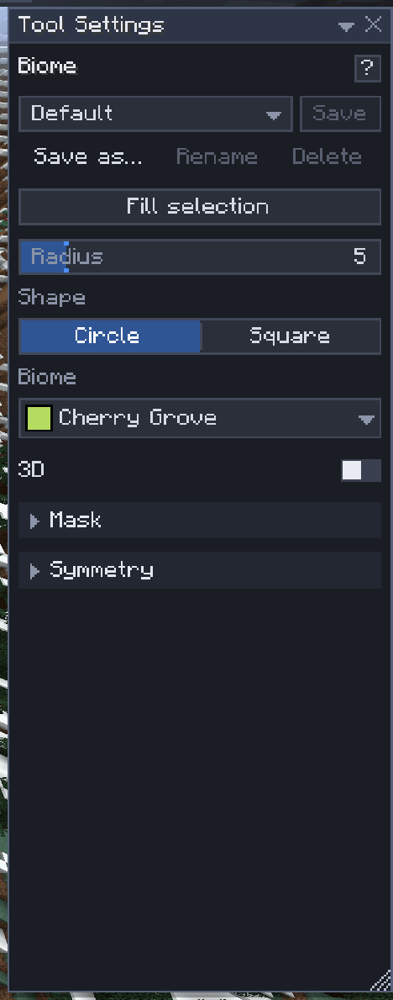
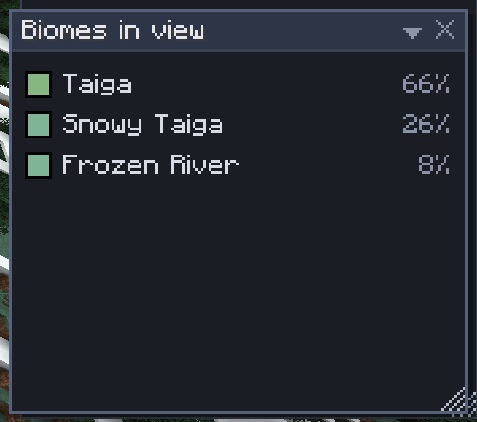

# Biomes

[Home](home.md) · [Shape the land](home.md#shape-the-land)

The **Biome** tool (`'`, the last palette slot) paints biomes: pick one from the list and drag over the land, or fill the selection with it. Grass, leaves, water and sky take the new biome's colours at once, for everyone on the server, players without Sculptory included.

Minecraft keeps biomes in **biome cells** of 4×4×4 blocks, lined up on multiples of 4. That is the finest a biome can change, so borders are blocky at that size.

## Paint with the brush

1. Press `'`.
2. In Tool Settings, click **Biome** and pick one. The list holds every biome the server has, modded and data-pack ones included, each with its colour; type to search.
3. Point at the ground and left-drag. Each press is one undo step ("Biome stroke · N biome cells").
4. `Ctrl+Scroll` changes the radius (`Shift`: steps of 4).

By default the brush paints **whole columns**, from the bottom of the world to the top: every column of biome cells whose middle is inside the brush, and always the one under the cursor. Turn on **3D** to paint only the biome cells inside the brush's ball (or cube), for a cave, a sky island or a single floor.

## Fill the selection

**Fill selection** (above the Biome tool's settings, and **Fill biome** in the Selection window) sets every biome cell the selection touches to the tool's biome: whole columns, or with 3D on only the cells holding a selected block. It is one undo step ("Biome fill · N biome cells"), and the Select tool's symmetry applies.

## Settings

| Setting | What it does |
|---|---|
| Radius | 1–32 blocks (the server may allow less) |
| Shape | A circle (ball in 3D) or a square (cube in 3D) |
| Biome | The biome painted |
| 3D | Off (default): whole columns, judged at their ground. On: only the biome cells inside the brush |
| Mask | In columns mode a column is painted when the mask accepts its ground block; in 3D each cell is judged at its middle block. The global mask applies the same way |
| Symmetry | Mirrored or turned copies of each dab ([Symmetry](symmetry.md)) |

## Biomes in copy and paste

- **Copy** and **Cut** keep the biomes of the biome cells the copied blocks are in.
- **Paste** writes them only with **Biomes** ticked in the [Place](place.md) tool's settings (off by default, like WorldEdit's `-b`). Turned or flipped pastes turn the biomes with the blocks; the paste spot is rounded to the nearest biome cell, so the pattern keeps its shape.
- **Move** and **Stack** carry the biomes along only with **Biomes** ticked in the [Place](place.md) tool's settings, the same box Paste uses (off by default, and remembered). Unticked, the blocks move and the biomes stay where they were. Ticked, the source keeps its own biomes too (there is no "empty" biome). **Rotate…** in the Selection window is a move: it turns the biomes with the blocks when **Biomes** is ticked, and leaves them where they are otherwise. The [Extrude](extrude.md) tool leaves biomes where they are.
- `.schem` files keep biomes both ways ([Import and export](import-export.md)). Litematica and structure files have no biomes.

## Biome view

**View ▸ Biome view** tints the ground around you by biome and opens a small **Biomes in view** window listing them, most of the ground first. Only you see it. It updates as biomes change, yours or anyone else's.

## Undo

Biome strokes and fills undo and redo exactly, also after a server restart. A biome cell someone else painted since is kept and counted, like a changed block; **Undo anyway** takes it back too ([History](history.md)).

## Permissions

Painting, filling, and pasting, moving or stacking with Biomes ticked need the `biome` [permission](permissions.md) (op players have it). Without it the Biomes box is hidden.

## Related

- [Place](place.md)
- [Clipboard](clipboard.md)
- [Masks](masks.md)
- [History](history.md)
