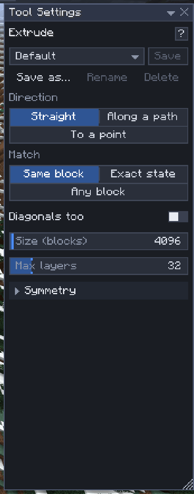

# Extrude

[Home](home.md) · [Shape the land](home.md#shape-the-land)

**Extrude** (`=`) takes a flat face of blocks, a wall, a floor, a ceiling or a roof slope, and pulls it out by whole layers, carves it in, or smears it along. It can also carry the face along a path you click, or taper it to a point. Use it to thicken a wall, cut a doorway, raise a floor, push a pillar out of a facade, bend a wall round a corner, or top a tower with a spire, without selecting anything first.

## Extrude a face

1. Press `=`.
2. Aim at a wall, floor or ceiling: the connected flat face of matching blocks lights up, so you see exactly what will move.
3. Left-drag away from the face to pull layers out, or into it to carve them away. The ghost shows the layers as you drag.
4. Let go to build it. `Esc` while dragging cancels.

One drag is one undo step, named **Extrude** or **Carve** in the History window.

## More ways to drag

| Drag | What it does |
|---|---|
| Left-drag | Pull the face out or carve it in |
| `Ctrl+drag` on a side of the selection | Works on that whole side of the selection box, whatever blocks it holds |
| `Alt+drag` | **Smear**: slides the face along its plane, copying it as it goes |
| `Alt+Shift+drag` | Slides the face out or in without leaving a copy behind |

## Extrude along a path

1. Set **Direction** to **Along a path**.
2. Aim at the face and click: it stays lit, **locked**, while you work on it.
3. Put [points](#points) for the path. It starts at the middle of the face and runs through the points, **Straight**, as a **Curve**, or **Hanging** with a **Sag**, as Generate's [Line](generate.md#draw-a-line) does.
4. The face follows the path, turning with it, and the ghost shows the result. A floor or ceiling turns as little as it can. A wall stays upright and only turns with the path; tick **Follow slope** to tilt it as the path climbs.
5. Press `Enter` to build. `Esc` clears the points; a second `Esc` lets go of the face.

The build is one undo step named **Extrude path**. Stairs and other blocks that face a way turn with the path to the nearest quarter turn.

## Extrude to a point

1. Set **Direction** to **To a point**, aim at the face and click to lock it.
2. Put the tip, a [point](#points), where the spire should end. It must be on the face's open side. A tip off to one side makes a leaning spire.
3. The face narrows layer by layer to the tip: a square face makes a pyramid, a round one a cone. **Taper** sets the sides: **Straight**, **Bulge** (rounded, like a dome) or **Pinch** (curving in, like a spire). Each layer keeps the face's own blocks.
4. Press `Enter` to build: one undo step named **Taper**.

Blocks with contents in the face, such as chests and signs, can't be carried this way: they are left out, and a message says how many.

## Points

Once the face is locked, a click puts a point on the block you aim at; aimed at open sky, it goes on the pale blue **marker** floating ahead of you (`Alt+Scroll` moves it nearer or farther). Points work the same way as for Generate's [Line](generate.md#points): click a point to select it, drag it to move it (dragged into the sky it keeps its distance from you; `Esc` while dragging puts it back), and `Backspace` or `Delete` removes the selected point, or the last one.

Points in the sky build from the ground straight up: a wall face carried straight up stays upright, a floor becomes a pillar, and with **Follow slope** a wall tilts flat as it climbs.

## Settings

| Setting | What it does |
|---|---|
| Direction | **Straight** (drag), **Along a path** or **To a point** |
| Match | Which blocks join the face: **Same block** (every oak plank), **Exact state** or **Any block** (everything but air) |
| Diagonals too | Blocks that touch the face only at a corner join it too |
| Size (blocks) | The face stops growing after this many blocks, default 4,096, and says so |
| Max layers | The most layers one drag pulls out or carves, default 32 (Straight) |
| Path, Sag | How the path runs through its points; how far a hanging span drops at its middle, 0–64 (Along a path) |
| Follow slope | A wall face tilts as the path climbs, instead of staying upright (Along a path) |
| Taper | **Straight**, **Bulge** or **Pinch** (To a point) |
| Symmetry | Repeat the drag on mirrored or turned copies of the face: see [Symmetry](symmetry.md) (Straight) |

## Tips

- Cut a doorway: select the opening with [Select](select.md), then `Ctrl+drag` its front side into the wall.
- Thicken a wall: aim at it and drag one layer out. Carve removes the face's layer, so the surface moves in by the number of layers.
- A face that stops early hit the **Size** limit: raise it, or use **Exact state** to keep other blocks out.
- Bend a wall round a courtyard: lock the end of the wall and click a **Curve** of points around it.
- Top a tower: lock its flat roof and click a block above its middle, or the marker in the sky; a tip off to one side leans the spire that way.
- Extrude needs the `region` [permission](permissions.md); along a path and to a point it also needs `clipboard`.

## Related

- [Select](select.md)
- [Generate](generate.md)
- [Shape brush](shape-brush.md)
- [Symmetry](symmetry.md)
