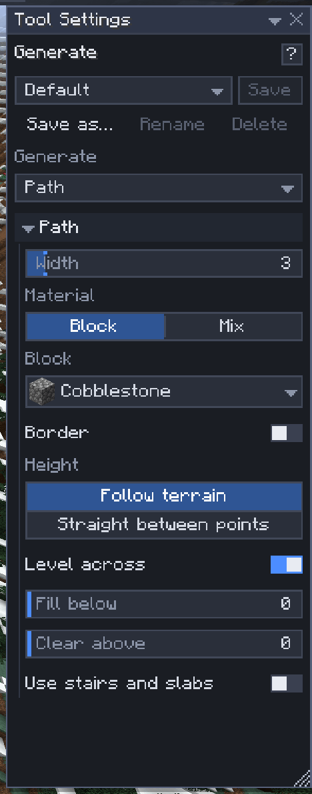

# Generate

[Home](home.md) · [Build faster](home.md#build-faster)

**Generate** (`-`) builds a **road** along points you click, a **roof** over the selection, a **line** through blocks you click, a **sweep** of the selection along a path, **stamps** of your clipboard on blocks you click, a **heightmap**: terrain shaped from a picture over the selection, or a **smart surface**: a sheet of land through points you click. It shows the result first, and `Enter` builds it as one undo step named **Road**, **Roof**, **Line**, **Sweep**, **Stamp**, **Heightmap** or **Smart surface**. Use it for paths that hug the land, embanked highways, roofs of stairs and slabs that would take an evening by hand, cables, pipes, arches and beams, walls with a profile of your own, rows of lamp posts or trees, and whole landscapes from a picture.

## Build a road

1. Press `-` and set **Generate** to **Path**.
2. Click the ground to add nodes, or put them in the sky ([points in the air](#points-in-the-air)). From two nodes on, the road's footprint is drawn on the terrain with a centre line, and the road itself as a ghost.
3. Move, insert and remove nodes as [path points](#path-points): click a node to select it and drag its arrows, click the centre line to add a node there, `Backspace` removes the selected node.
4. Press `Enter` to build. `Esc` deselects, then clears the path.

## Build a roof

1. Select the building with [Select](select.md): the box's bottom layer is where the eaves sit.
2. Press `-` and set **Generate** to **Roof**. The roof's outline shows over the selection.
3. Choose the **Style**, **Pitch** and blocks, then press `Enter`.

## Draw a line

1. Press `-` and set **Generate** to **Line**.
2. Click blocks to add points, or click the marker in the sky ([points in the air](#points-in-the-air)); the line runs through their centres. A line or a sweep takes up to 64 points. Edit them as [path points](#path-points): select, drag, insert, remove.
3. Pick the **Path**: **Straight** from point to point, **Curve** smoothly through every point (drag the last point onto the first for a closed loop, of four points or more with the closing one), or **Hanging**, sagging between each pair of points by **Sag** blocks, like a rope or a power line.
4. Set the **Thickness** (1–16, `Ctrl+Scroll`) and, from 2 up, the **Profile**: **Round** or **Square**.
5. Tick **Extend to ground** to fill every column the line passes through down to the ground under it: a beam becomes a wall, a bridge stands on its supports. The fill goes straight down through plants, leaves, trunks, water and lava to the first other block, so over a forest it reaches the forest floor (the trees in its way are built over) and under an overhang it reaches the ground beneath. Tick **Use stairs and slabs** to smooth its slopes with the block's stairs and slabs.
6. Press `Enter` to build. `Esc` deselects, then clears the points.

## Sweep a profile

1. Build the profile: a slice of the wall, bridge or tunnel you want, usually one block thick, and select it with [Select](select.md).
2. Press `-` and set **Generate** to **Sweep**.
3. Click blocks for the path, as for a [line](#draw-a-line) ([path points](#path-points)). The profile stands on them, its bottom middle on top of each block, and turns to follow the path, staying upright. Tick **Follow slope** to tilt it as the path climbs, and **Extend to ground** to fill each column of the sweep down to the ground (each column with its lowest block, through trees as for a line), so a wall profile stands on the terrain.
4. Press `Enter` to build: one undo step named **Sweep**.

A profile thicker than one block repeats along the path: a fence profile three blocks thick with a post in one slice puts a post every three blocks. Stairs and other blocks that face a way turn with the path to the nearest quarter turn. Air in the profile is not swept, and blocks with contents (chests, signs) are left out, with a message.

## Stamp copies

1. Copy something (`Ctrl+C`), or pick a saved build in the [Library](library.md) and click **Stamp**.
2. Press `-` and set **Generate** to **Stamp** (the Library's **Stamp** button does this for you and sets **Copy** to **Library asset**).
3. Click blocks: a copy stands on each, as a paste would (or on the marker's block in the sky: [points in the air](#points-in-the-air)). The first copy is as you copied it; the others turn with the path through the points, by any angle, as a pasted copy turned in the [Place](place.md) tool does, but always with the Nearest method, whatever [Free rotation](free-rotation.md)'s **Method** says (stairs and other blocks that face a way take the nearest facing). `R` turns every copy a quarter more. Move, insert and remove the points as [path points](#path-points).
4. Press `Enter` to build: one undo step named **Stamp**, at most 256 copies at once.

Stamps are pasted by the server from its own copy, so chests keep their contents and entities such as armor stands and item frames come along.

## Path points

The Road's nodes, the Line's, Sweep's, Stamp's and [Smart Surface](smart-surface.md)'s points, Extrude's path and tip, and the [Shape brush](shape-brush.md#sweep-a-shape-along-a-line)'s line all work the same way.

- **Add**: click a block to put a point on it, or open sky to put one at the [marker](#points-in-the-air). The new point is the end of the path and is selected, so the next click carries the path on from it: while the end point is selected a thin dark line runs from it to a small cube under the cursor, where the next point would go.
- **Select**: click a point. Points are translucent cubes; the selected one shows a gizmo: a white cube at its middle, red, green and blue arrows, and three coloured squares. The part under the cursor lights up.
- **Move**: drag an arrow to move the point along that axis only (the green one straight up and down), a square to move it in that square's plane (the flat green one slides it sideways at its height), or the white cube to move it freely, keeping its distance from you; `Alt+Scroll` while dragging pushes it out or pulls it in. Dragging a point you have not selected moves it freely too. Long lines along the axes you drag on show where it is going. A dragged point never jumps onto the block under the cursor, but it does snap onto another point you aim at (drag the last point onto the first to close a Curve into a loop). If you fly while holding it, it comes along. `Esc` while dragging puts it back.
- **Insert**: hover the path between two points (it lights up) and click to put a point there. Or select a point and press `E`: a new point after it follows the cursor until you click to place it (`Esc` drops it). With no point selected, `E` opens your inventory as always.
- **Remove**: `Backspace` (or `Delete`) removes the selected point and selects the one before it; with nothing selected it removes the last one.
- **Deselect**: `Esc`. With a point in the middle of the path selected, a click away from the points only deselects; a second `Esc` clears all the points.

`Ctrl+Z` undoes builds, not point edits. The insert key can be changed in the [Keys](keys.md) window.

## Points in the air

The Road, Line, Sweep, Stamp and [Smart Surface](smart-surface.md) (and [Extrude](extrude.md)'s path and tip) take points in the sky as well as on blocks. Aim at open sky: a pale blue box with a cross, the **marker**, floats ahead of you, its distance beside the cursor. Click to put a point there. With the cursor on a block, the point goes on the block as usual.

- `Alt+Scroll` moves the marker a block nearer or farther, `Shift+Alt+Scroll` four blocks, from 2 to 256 blocks away (never past what your render distance lets the editor aim at, nor out of the world's height). It starts at 16, is shared by the Road, Line, Sweep, Stamp and Smart Surface (Extrude has its own), and keeps your distance while the game runs. `Ctrl+Scroll` still sets the road's width and the line's thickness.
- Click a point floating in the air to pick it. While your aim would pick a point, that point lights up instead of the marker: aim beside it to place a new point farther out.
- A road node left in the air when you place it or let go of it (nothing solid in its block or the one under it) sets **Height** to **Straight between points** (a message says so), so the road runs through its nodes: a floating deck with nothing under it. `Esc` clearing the road puts **Height** back. With **Straight between points**, **Fill below** only fills where something lies under the deck within its depth, so a ramp up from the ground keeps its embankment near the ground and becomes a bare deck higher up; where the road crosses chunks your game hasn't loaded it is a bare deck too, and a message counts those columns. With **Follow terrain** the fill is as before.

## Import a heightmap

1. Select the area with [Select](select.md). Its footprint is where the picture goes; its bottom and top become **Min Y** and **Max Y**.
2. Press `-` and set **Generate** to **Heightmap**.
3. Click **Picture** and pick one: a built-in or one of your own PNGs (as for the [Heightmap brush](heightmap.md#your-own-pictures)).
4. Set **Min Y** (the ground where the picture is black) and **Max Y** (where it is white). They start at the selection's bottom and top each time you select something new, and may reach beyond it.
5. **Turn** the picture in quarter turns, or **Invert** it (a hill becomes a pit). The ghost shows the result.
6. Press `Enter` to build.

The picture is stretched over the whole footprint, so a wide selection makes a wide hill. In each column the ground is set to the picture's height: everything above it, up to the top of the selection (or Max Y), becomes air, trees and water included; below it the column keeps its own blocks, as with the [Heightmap brush](heightmap.md#raise-and-lower): grass stays on top, the dirt beneath grows or is cut.

## Smart Surface

Set **Generate** to **Smart Surface**, click blocks round an area for its outline and inside it for hills and hollows: a terrain-like sheet fills the outline through every point. See [Smart Surface](smart-surface.md).

## Settings

| Setting | What it does |
|---|---|
| Width | Road width, 1–32; `Ctrl+Scroll` |
| Material | One **Block**, or a weighted **Mix** ([mix patterns](mix-patterns.md)); **Border** adds a second block for the outer columns |
| Height | **Follow terrain** (smoothed along the road) or **Straight between points** |
| Level across | One height across the road's width, or each column on its own ground |
| Fill below, Clear above | Blocks filled under the road (Straight between points: only where they reach the ground), and cleared above it, 0–8 |
| Use stairs and slabs (Road) | On sloping stretches each step up becomes a stair facing up the climb (or a slab, when the block has no stair) of the road's own block; a block with neither stays full, and a message says so |
| Style | **Gable**, **Hip** or **Shed** (rising from the **Low side**) |
| Pitch | **45° (stairs)**, **Steep** (two up per one across, full blocks) or **Gentle** (one up per two across, slabs) |
| Ridge along, Overhang, Thickness | Which way a gable's ridge runs, how far the eaves reach past the box (0–4), layers under the surface |
| Stairs, Slab, Full block | The roof's blocks: picking the stairs fills in the slab and full block of the same wood or stone |
| Gable walls, Inside | Fill the triangular ends; leave or hollow the space under the roof |
| Path, Sag | The line's shape through its points; how far a hanging span drops at its middle, 0–64 |
| Thickness, Profile | The line's width across, 1–16; round (a tube) or square (a beam) |
| Material (Line) | One **Block**, or a weighted **Mix** |
| Extend to ground (Line) | Fill every column the line passes through down to the ground under it, through plants, leaves, trunks, water and lava |
| Use stairs and slabs (Line) | The line's steps up become stairs facing up the climb, upside-down stairs under it, or slabs, of each block's own family |
| Path, Sag (Sweep) | The sweep's path through its points; how far a hanging span drops at its middle |
| Follow slope | The profile tilts as the path climbs, instead of staying upright |
| Extend to ground (Sweep) | Fill each column of the sweep down to the ground (through trees, as for a line), with its lowest block |
| Copy | What Stamp copies: your **Clipboard**, or the **Library asset** picked with the Library's **Stamp** button |
| Picture | The height picture of a Heightmap import |
| Min Y, Max Y | The ground's height where the picture is black, and where it is white |
| Turn, Invert | Turn the picture 0°, 90°, 180° or 270° clockwise; swap high and low |

## Tips

- **Clear above** cuts the road through a forest; **Fill below** builds an embankment across a dip.
- Pick the **Stairs** block first: the slab and full block fill in when they share its name.
- With **Follow terrain**, chunks the road crosses that your game hasn't loaded show as red boxes and stop the build: fly closer. A **Straight between points** road builds a bare deck there instead ([points in the air](#points-in-the-air)).
- A thin **Hanging** line between two towers makes a cable or a rope; a thick **Curve** of stone makes an arch. Blocks are placed as they are: fences and walls in a line don't connect to each other.
- A line reaching into chunks your game hasn't loaded won't build: fly closer.
- **Extend to ground** looks through plants, leaves, tree trunks, water and lava, and stops on anything else: a roof, a fence or a chest under the line holds the fill up, as the ground does. A column where nothing lies below gets no fill.
- A sweep needs a selection: the profile is read when you click, so change the selection and the ghost follows.
- Where two stamped copies overlap, the one clicked later wins.
- A heightmap import clears everything above the new ground inside the selection: select only the land, not the houses next to it. Chests, furnaces, signs and other blocks with contents are left exactly as they are (a message counts them). A column's ground is its topmost solid block, so a tree trunk or a roof inside the selection is taken for ground (its block is what the column grows or is cut to): clear them first.
- Generate needs the `clipboard` and `region` [permissions](permissions.md).
- The [Shape brush](shape-brush.md#sweep-a-shape-along-a-line) sweeps any of its shapes along the same kind of line, and can carve with it.

## Related

- [Select](select.md)
- [Extrude](extrude.md)
- [Library](library.md)
- [Heightmap brush](heightmap.md)
