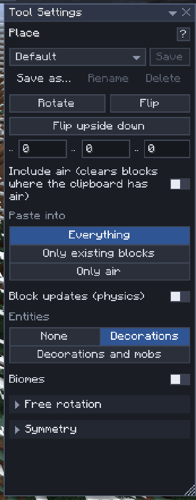

# Place

[Home](home.md) · [Copy, paste and share](home.md#copy-paste-and-share)

**Place** (`8`) puts blocks down from the [clipboard](clipboard.md) or a [library](library.md) asset, and moves or stacks the selection. A ghost shows the result at the pointer first; you turn, flip and nudge it, then confirm with `Enter`. Every placement is one undo step.

## Paste

1. Copy something (`Ctrl+C`), import a file or pick a library asset.
2. Press `Ctrl+V`: the ghost follows the pointer. The tool switches to Place by itself.
3. Left-click to drop the ghost where it is. Drag the gizmo's arrows to move it along an axis, and its rings to turn it (below).
4. Fine-tune: `R` and `Shift+R` turn it, `F` and `Shift+F` mirror it, `V` turns it upside down, the arrow keys and `PgUp`/`PgDn` nudge it (`Shift`: 10 blocks).
5. Press `Enter` to place it, or `Esc` to cancel.

The same buttons sit above the settings: **Rotate · Flip · Flip upside down**. Under them are the three angles of the turn, **Yaw**, **Pitch** and **Roll**, in degrees. Used with no ghost showing, they set up the next paste instead: the Clipboard window then says "Next paste upside down".

## Turn by any angle

The gizmo has three rings: the green one turns the ghost around up, the red one around east-west and the blue one around north-south.

1. Drop the ghost, then drag a ring. It turns in steps of 15°; hold `Ctrl` to turn it freely.
2. Or type the angles into **Yaw**, **Pitch** and **Roll** in Tool Settings and press `Enter`.
3. `R`, `F` and `V` still turn, mirror and flip it by exact quarter turns on top of the angle.

Turned by an angle that isn't a multiple of 90°, the **Method** setting decides which block lands in each cell: Nearest (the default), Exact count or Smooth, and **Smooth slopes** can put stairs and slabs on turned slopes; see [Free rotation](free-rotation.md). Doors, beds and tall plants stay whole. Stairs, logs, pistons, observers and other blocks with a direction snap to the nearest facing, even sideways or upside down: a log can end up lying north-south, an observer can face up. Blocks that can't take that facing, such as slabs on their side, signs or rails, keep their nearest valid form, and a toast counts them once the ghost has settled. Entities turn with the blocks: armor stands and mobs face the new way, item frames and paintings go to the nearest wall (one left with no block behind it, or a painting that would face the floor or ceiling, is left out), and displays turn by exactly the angle. Turns of exactly 90°, 180° or 270° on any axis are exact.

While you drag a ring, the ghost turns as a solid; once you stop, it shows exactly what will be placed.

## Move or stack

1. Select the blocks with [Select](select.md).
2. Click **Move** or **Stack** in the Selection window.
3. Place and turn the ghost as above. An upright line marks the pivot the ghost hangs from and turns around; a move also draws a line from where the blocks were. For Stack, drag to set the step between copies and `Ctrl+Scroll` to set how many.
4. Press `Enter`.

Stacked copies keep the selection's orientation: `R`, `F` and the rings are refused, but `V` turns every copy upside down in its own box.

A selection moved by a free angle becomes a block selection of exactly the blocks it moved to. To turn blocks where they stand, use **Rotate…** in the Selection window: see [Selection operations](selection-operations.md#rotate).

## Upside down

`V` turns the contents over inside the same box: the box doesn't move. Stairs, slabs, doors, trapdoors, buttons, levers, lanterns, pistons and the like turn over. Torches, plants, signs, banners, beds, carpets, rails and chests can't be upside down, so they stay as they are, and a toast counts them once the ghost has settled. A two-block plant swaps its halves to stay whole.

## Settings

| Setting | What it does |
|---|---|
| Include air (clears blocks where the clipboard has air) | Off: the clipboard's air changes nothing. Pastes only |
| Paste into | **Everything**, **Only existing blocks** or **Only air** |
| Block updates (physics) | Sand falls, water flows (needs the `physics` permission) |
| Entities | Which entities a move or stack takes along |
| Biomes | Paste the clipboard's biomes too, or carry the selection's biomes along with Move and Stack (off by default; needs the `biome` permission, hidden without it). Unticked, biomes stay where they are: see [Biomes](biomes.md) |
| Method | How a turn by a free angle lands on the grid: **Nearest** (default), **Exact count** or **Smooth**. See [Free rotation](free-rotation.md#methods) |
| Smooth slopes | Stairs and slabs on the slopes of a free turn, for blocks that have them |
| Symmetry | Repeat the placement on mirrored or turned copies: see [Symmetry](symmetry.md) |

## Tips

- Paste with **Only air** to add around a build without overwriting it.
- A move that would put any of the blocks outside the world is refused ("The server couldn't apply that").
- A paste too large to preview shows an outline only, and no count toast.
- With **Symmetry** on, each copy of a turned paste or move is the exact mirror image of the original.

## Related

- [Clipboard](clipboard.md)
- [Selection operations](selection-operations.md)
- [Library](library.md)
