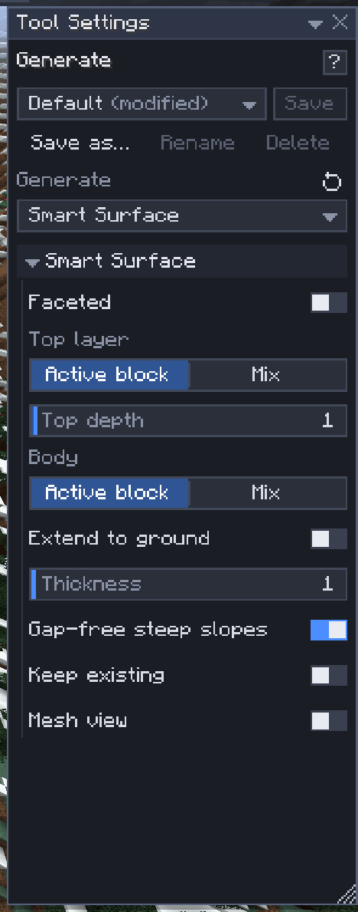

# Smart Surface

[Home](home.md) · [Shape the land](home.md#shape-the-land)

**Smart Surface** is a [Generate](generate.md) mode that fills an outline of points with a terrain-like sheet: you put points on blocks, they make a closed outline, and a surface stretches across it through every point, like a cloth laid over pegs. Use it for hillsides, ramps between two levels, dunes, the ground under a build, or a smooth patch of land where the terrain is broken. `Enter` builds it as one undo step named **Smart surface**.

## Use it

1. Press `-` and set **Generate** to **Smart Surface**.
2. Click blocks to put outline points on top of them, going round the area: the points join up in the order you click them, the last back to the first, with straight edges between them. A click on open sky puts a point at the marker, as for a [line](generate.md#points-in-the-air).
3. From three points on, the sheet shows as a ghost, with its terrace outlines drawn on top.
4. Click on the ground **inside** the outline to add an **inside point**: the sheet passes through it, so a high inside point makes a hill and a low one a hollow. A click **outside** the outline adds an outline point after the selected one (or after the last).
5. Press `Enter` to build.

| Key | What it does |
|---|---|
| Left-click | Add a point (inside the outline: an inside point; outside: an outline point), or select a point |
| Left-click on an edge | Insert an outline point there (the edge lights up under the cursor) |
| Drag an arrow, a square or the white cube | Move the selected point along one axis, in one plane, or freely at its distance from you |
| `E` | With a point selected: add one after it (an outline point after an outline point, an inside point beside an inside point) that follows the cursor until you click; `Esc` drops it |
| `Backspace`, `Delete` | Remove the selected point (or, with none selected, the last outline point) |
| `Alt+Scroll` | Move the sky marker nearer or farther, or a point you drag freely |
| `Enter` | Build the surface |
| `Esc` | Put back a point being dragged, or drop one being placed; else deselect the point; else stop a preview being made; again: clear the points |

Points move as on every path: see [Path points](generate.md#path-points). A dragged point never jumps onto the block under the cursor, it comes along if you fly while holding it, and the ghost follows as you drag.

## The surface

- The sheet has one top per column, so it never overhangs: each column inside the outline gets one surface block, and the surface passes exactly through every point, outline and inside.
- **Smooth** (the default) runs straight from point to point along the outline and bends smoothly inside it. A peak or a hollow keeps its full height at its point, rounding off around it; the sheet never goes higher than the highest point or lower than the lowest.
- **Faceted** makes flat triangles between the points instead. **Mesh view** draws the triangles over the preview in either mode.
- An outline may bend inward (an L or a U works). If it crosses itself, a column is in where an odd number of edges lie between it and the outside, so the overlap of a figure eight's loops, or the middle of a star drawn in one stroke, stays empty.
- An inside point dragged outside the outline is not used: it turns red.

## Fill

| Setting | What it does |
|---|---|
| Faceted | Flat triangles between the points instead of the smooth surface |
| Top layer, Top mix | The surface blocks: the **Active block** (the top bar's) or a weighted **Mix** ([Mix patterns](mix-patterns.md)) |
| Top depth | How many blocks deep the top layer is, from the surface down (0–64; 0: all body) |
| Body, Body mix | The blocks under the top layer: the active block or a mix |
| Extend to ground | Each column is filled straight down to the ground under it, so the surface stands on the land like a solid hill. It looks through plants, leaves, tree trunks, water and lava: over a forest it fills down to the real ground and replaces the trees in its way (unless **Keep existing** is on), and under an overhang it fills to the ground beneath |
| Thickness | Without Extend to ground: how thick the sheet is, 1–64 blocks |
| Gap-free steep slopes | Each column reaches down to meet its lowest neighbour, so a steep part has no holes in its face. Always on (and hidden) with Extend to ground |
| Keep existing | Fill air only: blocks already there stay |
| Mesh view | Draw the triangles the surface is made of |

The global [mask](masks.md) applies as to any edit: the ghost shows only what it lets through, and so does the build. The sheet goes through Generate's usual limits: at most 256 points, an outline at most 512 blocks across, and no more blocks than your clipboard limit; a message says what stops it. With **Extend to ground** a fill that would go deeper than that limit allows (over a deep valley or the sea) shows as too large. Columns in chunks your game hasn't loaded stop the build: fly closer.

## Tips

- Put outline points on the terrain at the edge of the area and the sheet meets the land there; add a few inside points for the shape you want.
- With **Extend to ground**, grass over dirt with **Top depth** 1 gives a natural hill; a mix of stone and andesite for the body shows on steep sides.
- **Keep existing** with **Extend to ground** fills the dips of rough terrain and around the trees without touching what stands there.
- Generate needs the `clipboard` and `region` [permissions](permissions.md).

## Related

- [Generate](generate.md)
- [Heightmap brush](heightmap.md)
- [Terrain brushes](terrain-brushes.md)
- [Masks](masks.md)
